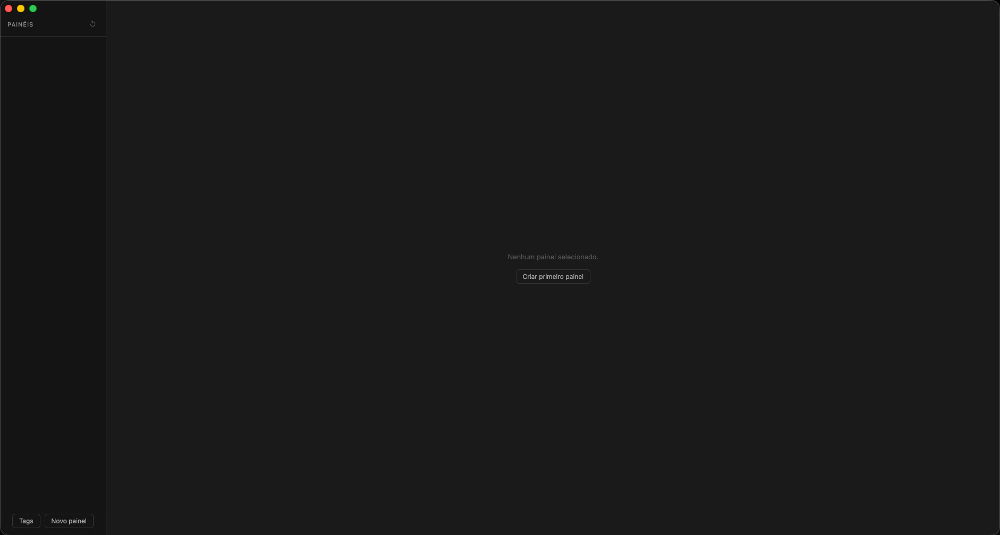
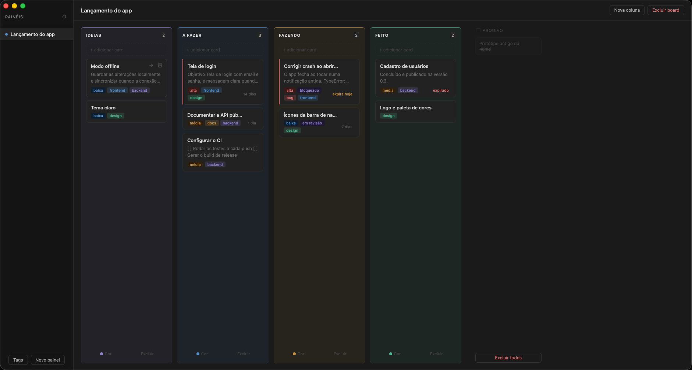

# Mova

Kanban pessoal, leve e local, para desktop. Feito com **Rust + Tauri** no backend e **JavaScript puro** no frontend, com tema escuro.





## Por que eu fiz

O Mova nasceu de uma dor minha: eu precisava de uma organização melhor no meu fluxo de trabalho. Fiz o app para **usar no meu dia a dia**, do jeito que eu queria, e cada ajuste que entrou nele veio de algo que me incomodou no uso de verdade.

## O que ele faz

- **Painéis, colunas e cards**: vários painéis, colunas com cor e cards que você arrasta para mudar de ordem ou de coluna. As colunas também podem ser arrastadas.
- **Seta para a próxima coluna**: cada card tem um botão que o manda para a coluna da direita, sem precisar arrastar.
- **Detalhes do card**: descrição em **Markdown** (títulos, listas, checklists clicáveis, citações, código e links), prioridade (alta, média ou baixa), prazo com aviso de "expira hoje" e "expirado", status livre (ex.: "bloqueado") e tags coloridas.
- **Tags globais**: uma biblioteca de tags compartilhada entre todos os painéis.
- **Arquivo**: cards arquivados saem do painel e podem ser restaurados.
- **Links seguros**: links da descrição abrem no navegador, e só `http`, `https` e `mailto` viram link.

## Onde ficam os seus dados

**Tudo fica no seu computador, em arquivos JSON.** Não há conta, servidor nem internet envolvidos.

- Um arquivo por painel: `boards/<id>.json`
- As tags globais: `tags.json`

| Sistema | Pasta |
|---|---|
| macOS | `~/Library/Application Support/mova/` |
| Linux | `~/.local/share/mova/` |
| Windows | `%APPDATA%\mova\` |

Como são arquivos JSON comuns, dá para fazer backup só copiando a pasta. A gravação é atômica (escreve num arquivo temporário e depois troca), então um travamento no meio não corrompe o painel. E se um arquivo estiver corrompido, o app pula esse painel e abre os outros.

## Próximos passos

1. **Exportar e importar** painéis.
2. **Salvar os dados na nuvem**, começando pelo **Google Drive**.
3. **Integração com o Google Agenda**, para os prazos dos cards aparecerem na agenda.

## Como rodar

**Pré-requisitos**

- Rust (via [rustup](https://rustup.rs))
- Node.js e npm
- macOS: as ferramentas de linha de comando do Xcode (`xcode-select --install`)
- Linux (Arch): `sudo pacman -S webkit2gtk-4.1 base-devel curl wget file openssl gtk3 libappindicator-gtk3 librsvg`

**Comandos**

```bash
npm install
npm run dev      # abre o app em modo de desenvolvimento
npm run build    # gera o instalador do seu sistema
```

Na primeira vez, o Cargo baixa e compila as dependências do Tauri, e isso demora alguns minutos.

## Testes

```bash
npm test                        # renderizador de Markdown (segurança contra HTML e links maliciosos)
cd src-tauri && cargo test      # armazenamento (ids válidos, gravação atômica, painel corrompido)
```

## Segurança

O texto dos cards é tratado como não confiável, porque a janela do app pode chamar comandos do Rust:

- o Markdown escapa todo HTML e aceita só links `http`, `https` e `mailto`;
- o app roda com uma Content Security Policy restrita (sem script de fora nem inline);
- o id de cada painel precisa ser um UUID válido, o que impede gravar ou apagar arquivos fora da pasta de dados.

## Arquitetura

```
src-tauri/            backend em Rust
  src/model.rs        estruturas: Board, Column, Card, Tag, Priority
  src/storage.rs      leitura e gravação dos JSON
  src/commands.rs     comandos chamados pelo frontend
src/                  frontend
  index.html          estrutura da tela
  styles.css          tema escuro
  markdown.js         renderizador de Markdown sem dependências
  main.js             estado, renderização, arrastar e soltar, modais
```

O frontend nunca toca no disco: toda leitura e gravação passa por um comando do Rust.

## Feito com IA

Este projeto foi construído com assistentes de IA (*vibe coding*): o código foi escrito pela IA. O meu papel foi decidir o que o app faz e como ele se comporta, testar o uso de verdade e pedir os ajustes, como a seta para a próxima coluna, os títulos cortados com "…" e o destaque de onde o card vai cair ao arrastar.

## Licença

[MIT](LICENSE)
